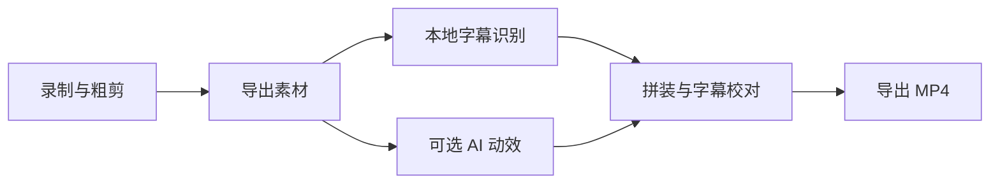

<p align="center">
  
</p>
<h1 align="center">SuperWorkspace</h1>
<p align="center"><b>从录屏到成片，在一个工作台完成。</b></p>
<p align="center">录制与粗剪 · 可选 AI 动效 · 本地字幕 · 多段拼装</p>
<p align="center"><code>macOS 14+</code> &nbsp; <code>Swift 6</code> &nbsp; <code>SwiftUI</code> &nbsp; <code>MIT</code></p>
<p align="center">
  <a href="#开始使用">开始使用</a> ·
  <a href="#工作流程">工作流程</a> ·
  <a href="#配置">配置</a> ·
  <a href="docs/PRD.md">功能说明</a>
</p>

---

SuperWorkspace 是一个原生 macOS 视频工作台。把屏幕演示与讲解录成素材，在应用内完成粗剪，再交给后台处理字幕与可选动效，最后按顺序拼成带字幕的视频。

录制器与工作台运行在同一进程内。打开项目后，点击「录制新素材」才会显示录制界面。

## 能做什么

| 环节 | 能力 |
| --- | --- |
| 录制与粗剪 | 内置屏幕、窗口录制与编辑界面，支持麦克风、系统声音和可选摄像头 |
| AI 动效 | 通过 Pi、Claude 或 Pi 的 DeepSeek 配置派发 Remotion 任务，使用随包提供的教程动效技能 |
| 字幕 | whisper.cpp 本地识别，可选 AI 结合画面文字校正，自动拆短并支持手动校对 |
| 拼装与导出 | 视频与字幕双轨时间线、拖放排序、播放头定位与缩放，以原生 AVFoundation 合成带字幕的 MP4 |
| 原生体验 | SwiftUI 界面，支持跟随系统、浅色和深色外观 |

**当前提供源码构建。** 字幕设置可检查工具、选择模型并测试识别；已有 Homebrew 时可安装字幕工具。模型和 AI 执行器需另行准备；未提供安装包或模型下载器。

## 开始使用

### 环境

- macOS 14 或更新版本；本地已在 Apple Silicon 上验证。
- Xcode 26+、Python 3 和 Git。首次运行 Xcode，完成其工具安装与许可设置。
- 打包 `.app` 需要本机可用且未过期的代码签名证书。构建会优先选择 Developer ID、Apple Development 或 Mac Developer 身份，也可用 `CODE_SIGN_IDENTITY` 指定。

### 构建并启动

```bash
git clone https://github.com/FlashingChen/SuperWorkspace.git
cd SuperWorkspace
./install-app.sh
```

首次构建会获取固定版本的 DogSC 源码，将其适配为同进程录制库，再编译、签名并启动应用。依赖目录留在本地，不纳入本仓库。

安装脚本将应用放进当前账户的 Applications 目录，并创建桌面启动入口。仅构建应用包：

```bash
./build-app.sh release
```

首次录制按系统提示授予屏幕录制和辅助功能权限；使用麦克风或摄像头时分别授予相应权限。

## 工作流程



1. **新建项目。** 每个项目可以包含多段录制素材。
2. **录制新素材。** 在内置界面录制、粗剪，导出时决定是否添加 AI 动效。
3. **查看后台处理。** 字幕与动效状态显示在素材旁，可取消或重试。动效完成前可直接使用原片预览和导出。
4. **拼装与校对。** 在视频与字幕双轨时间线上定位，拖动视频片段排序；选中素材或字幕后拖动两端边缘调整时长，字幕也可整体拖动；剪刀或 Command-B 在播放头处分割素材。右侧用于校对字幕文字。预览与导出共用字幕样式；编辑支持撤销与重做，切换页面或重启后恢复工作位置、缩放和区域比例。
5. **导出成片。** 在导出面板选择画幅、是否嵌入样式字幕以及是否另存 SRT 文件；字幕未就绪时可关闭字幕选项。导出显示实际进度并可取消，完成后保留播放和 Finder 入口。

素材卡片右上角的三个点菜单和时间线视频片段的右键菜单提供「删除素材」。确认后移除该素材及对应字幕并取消处理任务，原始文件保留。录制素材导出中或项目导出中暂不允许删除。

## 配置

### 字幕

安装命令行工具：

```bash
brew install ffmpeg whisper-cpp
```

在「设置 → 字幕」中选择 whisper.cpp 的 GGML `.bin` 模型和识别语言，再点击「测试字幕识别」验证工具及模型。已有 Homebrew 时可在设置中安装字幕工具。工具会从常见 Homebrew 与系统可执行目录中查找。

语音识别在本机执行。「AI 校正字幕」默认开启，沿用已配置的 AI 执行器，将字幕与本机提取的视频画面文字分批交给模型，辅助纠正同音词、术语与英文拼写。拼装页的「AI 校正」也可处理已有字幕，无需重新识别声音。

AI 仅返回文字，原时间段由应用保留；结果缺项、明显改写、超时或执行失败时保留本地字幕并显示可重试提示。原始识别结果单独保存。中文每条约 18 字，优先按标点与词边界拆分；新增细分时间按文字长度在原时间段内估算。已有字幕重新打开应用后也会拆短。最终导出时将字幕合成到画面。

### AI 动效

在「设置 → AI 动效」中选择已安装并完成认证的执行器：

| 模式 | 配置 |
| --- | --- |
| 自动 | 查找 Pi 或 Claude，也可指定自定义可执行文件 |
| Pi / Claude | 使用对应的本机命令行执行器 |
| DeepSeek（Pi） | 使用 Pi 已有的 DeepSeek 配置；模型名可在设置中调整 |

执行器还需能运行 Remotion 及其所需的 Node.js、渲染工具与依赖。应用携带独立的 `workspace-tutorial-motion` 技能；Pi 模式关闭默认技能发现，仅显式加载该技能。

追加参数每行一个，支持 `{source1}`、`{source2}`、`{brief}`、`{workdir}` 占位符。动效结果会检查时长与音轨是否保留；画面内容是否恰当仍需预览确认。

## 数据与隐私

项目、录制素材、字幕、动效工程及成片保存在当前账户的影片目录中，由应用按项目组织，不写入源码目录。

语音识别与视频拼装在本机完成。**启用 AI 字幕校正会向已配置的模型服务发送字幕与提取的画面文字；启用 AI 动效时，外部执行器也可能按其配置发送素材、文字或任务信息**。在字幕设置关闭 AI 校正后，仅使用本地识别与分段。

## 开发

```bash
python3 scripts/prepare-recorder.py
swift test
python3 scripts/audit-public.py
```

`prepare-recorder.py` 自动获取并核验固定依赖版本，再生成忽略目录内的 `RecorderKit`。已有依赖版本不符或存在本地修改时会停止，不自动替换。

| 目录 | 内容 |
| --- | --- |
| `Sources/SuperWorkspace` | 原生界面、项目状态、字幕、拼装与导出 |
| `Integration` | 录制组件的宿主适配层 |
| `Resources` | 应用元数据与权限声明 |
| `scripts` | 依赖获取、适配、图标生成、签名与公开内容检查 |
| `Tests` | 录制集成、任务状态、字幕与视频合成测试 |

应用图标与侧栏标识共用 `WorkspaceBrand` 矢量源，打包时生成多尺寸 ICNS。界面规范见 [DESIGN.md](docs/DESIGN.md)，贡献代码前请阅读 [AGENTS.md](AGENTS.md)。

## 许可证与致谢

本仓库代码采用 [MIT License](LICENSE)。录制与粗剪基于 [DogSC](https://github.com/laogou717/dogsc)，其源码以固定版本在构建时获取；打包时保留原始 MIT 许可证与字体许可。完整依赖说明见 [THIRD_PARTY_NOTICES.md](THIRD_PARTY_NOTICES.md)。
