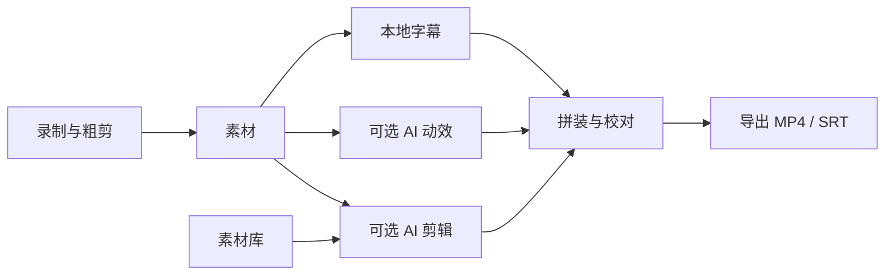

<p align="center">
  
</p>
<h1 align="center">SuperWorkspace</h1>
<p align="center"><b>从录屏到成片，在一个工作台完成。</b></p>
<p align="center">录制与粗剪 · 本地字幕 · 可选 AI 动效与 AI 剪辑 · 多段拼装与导出</p>
<p align="center"><code>macOS 14+</code> &nbsp; <code>Swift 6</code> &nbsp; <code>SwiftUI</code> &nbsp; <code>MIT</code></p>
<p align="center">
  <a href="#下载与安装">下载与安装</a> ·
  <a href="#工作流程">工作流程</a> ·
  <a href="#配置">配置</a> ·
  <a href="docs/PRD.md">功能与流程</a> ·
  <a href="docs/QUICKSTART.md">快速入门</a>
</p>

---

SuperWorkspace 是一个原生 macOS 视频工作台。以项目为单位，把屏幕演示与讲解录成素材，在应用内完成粗剪，再交给后台处理字幕与可选动效，最后按顺序拼成带字幕的视频。

录制器以同进程组件运行，不单独启动应用。预览与成片共用同一套 AVFoundation 合成实现，字幕样式、裁剪与排序在两处保持一致。功能、流程与状态规则见 [docs/PRD.md](docs/PRD.md)。

## 能做什么

| 环节 | 能力 |
| --- | --- |
| 录制与素材 | 同进程录制屏幕、窗口与可选摄像头，支持麦克风与系统声音；在内置粗剪后导出为项目素材 |
| 素材库 | 导入图片与视频作为补充画面，手写说明或由视觉模型生成一句描述 |
| 字幕 | whisper.cpp 本地识别，自动按显示宽度拆条；可选 AI 结合画面文字与联网查证校正；拼装阶段 AI 复核会整轨重建字幕（文字、断句与时间），并支持手动增删、合并、分割 |
| AI 动效 | 先在本机分析画面分区与切点，再由内置 Pi 或 Claude CLI 用 Remotion 渲染；结果校验时长与音轨后回填 |
| AI 剪辑 | 依据字幕、剪辑提示词和素材库挑选补充画面，可在录制导出时规划，也可在成片导出时统一规划 |
| 拼装与导出 | 视频与字幕双轨时间线、排序、裁剪、分割、字幕增删与复核、撤销重做；导出 MP4，可选嵌入字幕并另存 SRT |

## 下载与安装

从 [GitHub Releases](https://github.com/FlashingChen/SuperWorkspace/releases) 下载 Apple Silicon 安装包（DMG 或 ZIP），按[快速入门](docs/QUICKSTART.md)完成第一次录制。发行包已包含 Pi、Node.js、FFmpeg、whisper.cpp 与默认语音模型，不连接 AI 也能录制、识别字幕、拼装和导出。

- 系统要求：macOS 14 或更新版本；发布包仅提供 Apple Silicon 版本。
- 首次录制的权限授予、临时签名与 Gatekeeper 处理见快速入门。

## 源码构建

环境要求：

- macOS 14 或更新版本；开发构建在 Apple Silicon 上验证。
- Xcode 26+、Python 3、Git 与 CMake。首次运行 Xcode，完成其工具安装与许可设置。
- 常规打包使用本机可用的代码签名证书，优先选择 Developer ID、Apple Development 或 Mac Developer 身份，也可用 `CODE_SIGN_IDENTITY` 指定；`SUPERWORKSPACE_SIGNING=adhoc` 生成临时签名构建。

```bash
git clone https://github.com/FlashingChen/SuperWorkspace.git
cd SuperWorkspace
./install-app.sh
```

首次构建会获取固定版本的 DogSC 源码，适配为同进程录制库，再准备 Pi、FFmpeg、whisper.cpp 与语音模型，最后编译、签名并启动应用。依赖目录留在本地，不纳入本仓库。

```bash
./build-app.sh release                 # 只构建 .app
SUPERWORKSPACE_SIGNING=adhoc ./build-app.sh   # 临时签名构建
```

### 发布版本

完成源码与可达历史的公开发布审查后，将 `vX.Y.Z` 格式的标签推送到 GitHub。工作流会校验标签对应的源码、运行公开内容检查与 Swift 测试、构建并检查内置 Pi 与媒体工具，再发布 Apple Silicon ZIP、DMG 和 SHA-256 校验文件。标签决定应用版本号。

## 工作流程



1. **新建项目。** 每个项目可以包含多段录制素材，并共享一份素材库。
2. **录制素材。** 在内置界面录制、粗剪，导出时决定是否添加 AI 动效、是否按素材库规划补充画面，以及填写剪辑提示词。
3. **等待后台处理。** 素材导出完成后，本地字幕与可选 AI 动效、AI 剪辑分别派发；状态可查看，任务可取消或重试。动效完成前可直接使用原片预览和导出。
4. **拼装与校对。** 按顺序排列素材，拖动两端调整入出点，在播放头处分割；校对字幕文字与时间，用「AI 复核」检查全部字幕的时长、断句与错字，再按需删除、合并或新增字幕。原始素材就绪后即可预览，预览与导出共用同一合成实现。
5. **导出成片。** 选择画幅，决定是否嵌入样式字幕、另存 SRT 文件，以及是否在导出时执行 AI 剪辑。字幕未就绪时可关闭字幕选项直接导出视频。

## 配置

### 字幕

应用默认使用内置 FFmpeg、whisper.cpp 与多语言 Whisper Base。可在「设置 → 字幕」更换 GGML `.bin` 模型或识别语言，再点「测试字幕识别」验证配置。缺少工具且本机已有 Homebrew 时可一键安装。

语音识别在本机执行。**「AI 校正字幕」默认开启**，沿用已配置的 AI 执行器，把字幕与本地提取的画面文字分批交给模型，辅助纠正同音词、术语与英文拼写；需要核实专有名词时会调用随包搜索工具联网查证。模型只返回按编号对应的文字，时间码由应用保留。结果缺项、明显改写、超时或执行失败时保留本地字幕并显示可重试提示，原始识别结果单独保存。

进入拼装阶段后可以点「AI 复核」：模型会拿到每条素材的完整字幕、片段范围与画面文字，直接重建整条字幕轨——改错字、重新断句、调整时间，不再逐条给建议。字幕长短与断句由模型根据语义、语速和可读性决定；应用只校验内容、语言与时间几何，不设固定字数上限。应用会核对内容没有增删、语言没有被翻译、时间不重叠，然后整体替换；整次重建可一步撤销。复核期间被手动改过的素材会跳过，不会覆盖你的修改。没有 AI 连接时只做本地检查与明显碎句合并。字幕也可以直接新增、删除、与下一条合并，或在播放头处分割。

### AI 连接

AI 连接同时服务字幕校正与复核、素材描述、AI 剪辑与 Remotion 动效。在「设置 → AI 动效」中选择：

| 模式 | 配置 |
| --- | --- |
| 内置 Pi | 填写兼容 OpenAI Chat Completions 的 API 基础地址、模型和密钥，测试连接后保存。密钥保存在 macOS 钥匙串。模型支持图片时可开启「模型支持图片」，用于画面分析、素材描述与 AI 剪辑的视觉判断。 |
| Claude CLI | 使用已安装并认证的 Claude 执行器，可追加参数。追加参数每行一个，支持 `{source1}`、`{source2}`、`{brief}`、`{workdir}` 占位符。 |

应用包含 Pi SDK、Node.js 与 npm。动效需要支持工具调用的模型，并沿用随包的 `workspace-tutorial-motion` 技能；首次动效任务会准备 Remotion 与浏览器渲染环境。字幕校正不使用图片输入，素材描述发送单张画面截图。

### 素材库说明

素材库中的图片与视频会随任务交给模型判断适合讲什么。说明可手写，也可在启用图像模型后由应用生成一句中文描述；开启「为素材库素材自动生成描述」后，导入时会自动补齐缺失说明。

## 数据与隐私

项目、素材、字幕、素材库副本、动效工程与成片保存在当前账户的影片目录中，由应用按项目组织，不写入源码目录。AI 密钥保存在 macOS 钥匙串，不进入项目文件。

**语音识别、画面分析与视频拼装在本机完成。** 以下功能会把项目数据发送给已配置的模型服务：

- AI 字幕校正：字幕与本地提取的有限画面文字，可能包含用于专有名词核实的检索词。
- AI 字幕复核：该录制的整条字幕轨、素材时长、片段入出点与本地提取的有限画面文字。
- 素材描述：素材库素材的一张画面截图。
- AI 剪辑：字幕、剪辑提示词、素材名称与说明、素材库画面及其中可见文字。
- AI 动效：源帧、画面分析结果、字幕摘录、素材库画面与任务说明。

在字幕设置关闭 AI 校正与 AI 复核后，字幕只使用本地识别、分段与本地检查。首次动效任务与依赖安装需要访问软件源下载运行环境。

## 开发

```bash
python3 scripts/prepare-recorder.py
swift test
python3 scripts/audit-public.py
```

`prepare-recorder.py` 自动获取并核验固定依赖版本，再生成忽略目录内的 `RecorderKit`。已有依赖版本不符或存在本地修改时会停止，不自动替换。发布前运行公开内容检查，并人工检查全部待发布文件与可达历史；自动扫描不能代替内容审阅。

| 目录 | 内容 |
| --- | --- |
| `Sources/SuperWorkspace` | 原生界面、项目状态、字幕、AI 任务、拼装与导出 |
| `Sources/AudioWriterBridge` | 录音写入桥接 |
| `Integration` | 录制组件宿主适配、Pi 运行时与 Remotion 依赖清单 |
| `Resources` | 应用元数据与权限声明 |
| `scripts` | 依赖获取与适配、图标生成、签名、打包与公开内容检查 |
| `Tests` | 录制集成、任务状态、字幕编辑与重建校验、素材库、AI 规划与视频合成测试 |

构建脚本把 Pi、Node.js、FFmpeg、whisper.cpp、语音模型与 Remotion 依赖清单放入应用包；测试包含无界面端到端验收路径。应用图标与侧栏标识共用 `WorkspaceBrand` 矢量源，打包时生成多尺寸 ICNS。

文档分工：[PRD](docs/PRD.md) 描述能力、流程与状态规则；界面与控件的实现约定见 [AGENTS.md](AGENTS.md)，颜色、字体与尺寸取值以 `Theme.swift` 为准。

## 许可证与致谢

本仓库代码采用 [MIT License](LICENSE)。录制与粗剪基于 [DogSC](https://github.com/laogou717/dogsc)，其源码以固定版本在构建时获取；打包时保留原始 MIT 许可证与字体许可。完整依赖说明见 [THIRD_PARTY_NOTICES.md](THIRD_PARTY_NOTICES.md)。
